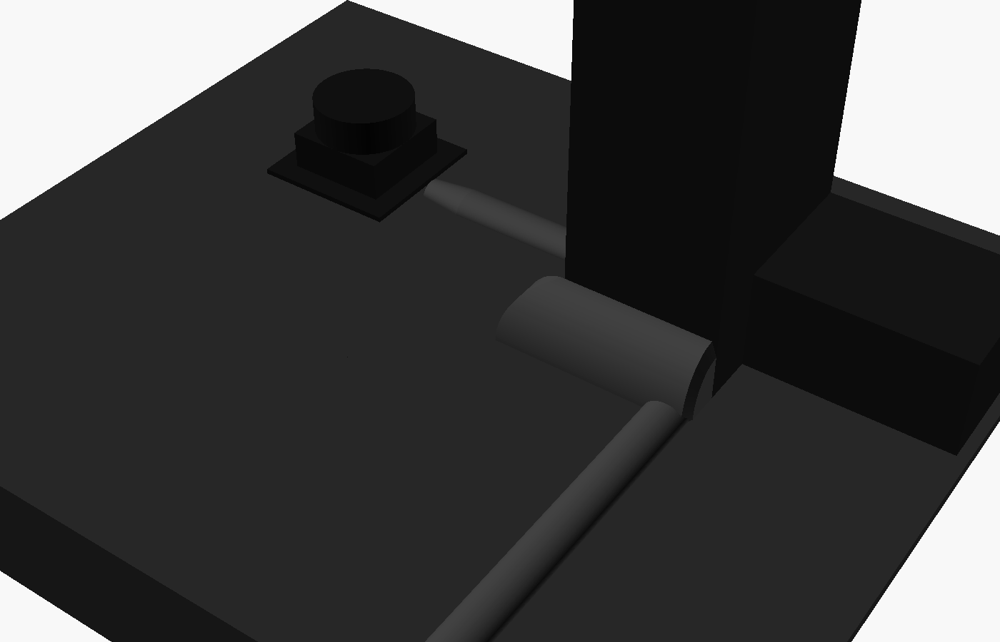
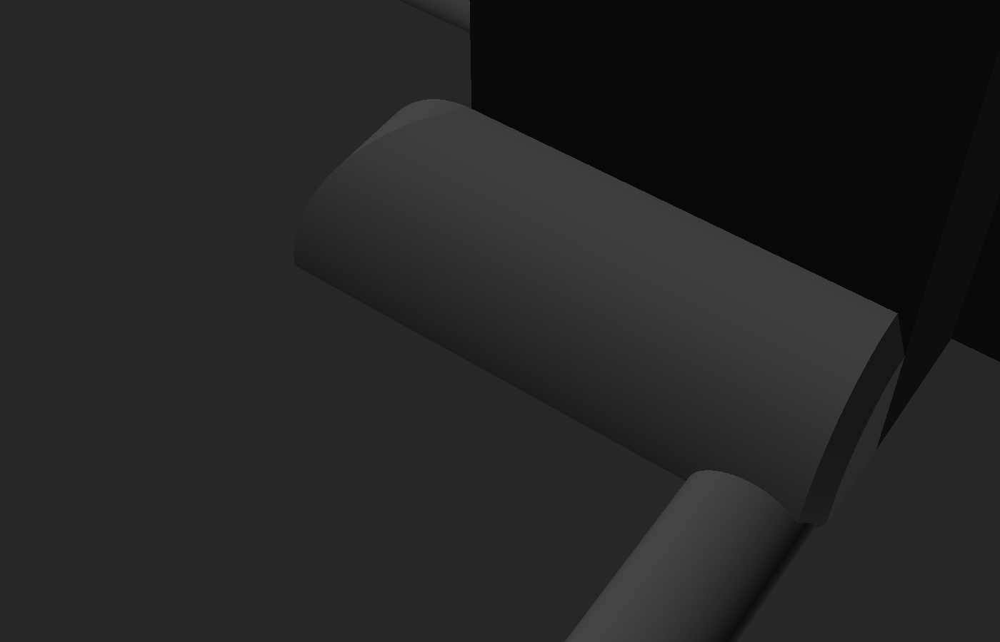
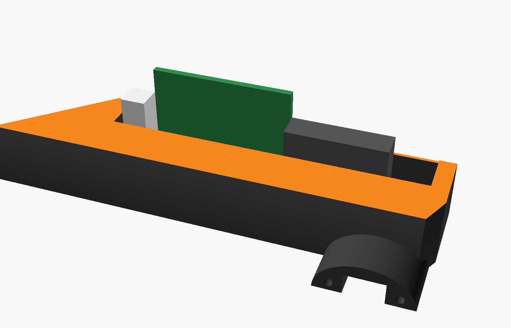

# RPLIDAR cable cover kit (v4 – fitted)

This version is sized to measurements taken on the robot. The cover hugs the mast column, hides the USB adapter board along the column's front face, and runs straight to the deck edge and down into the electronics bay.

| Corner where the side strip meets the housing | Board in the housing (cutaway) |
|---|---|
|  |  |

## Measurements used
| What | Measured | In the model |
|---|---|---|
| Column front face width | 3 5/16" | `col_w = 84` |
| Column front face → deck front edge | 9 1/8" | `col_to_edge = 232` |
| Adapter board width | 1" | `board_w = 25.4` |
| Board length incl. white JST | 1 9/16" | `board_len = 40` |
| Logitech USB-C plug overmold | ~1" | `plug_len = 24` |
| Lidar position (estimated from the top-down photo) | ~120 mm left of the column, ~60 mm behind its front face | `lidar_len = 100`, `side_len = 80`, `entry_at = 20` |

## Parts (print 1 of each)
| File | Size (L × W × H mm) | What it does |
|---|---|---|
| `lidar_run.stl` | 100 × 22 × 8 | Low dome from the lidar. Its tapered nose sits at the lidar mount. |
| `side_strip.stl` | 80 strip + corner | Quarter-round strip along the column's lidar-side face. It has a built-in T-junction for the lidar run, then grows to the housing's size and meets it at a 45° joint at the column's front corner. |
| `front_housing.stl` | 84 across the column × 24 out × 34 tall | Runs across the column's front face. The board stands on its edge inside, with the white JST connector at the lidar end and the USB-C plug toward the far end. The USB cable turns out through a stub toward the deck edge. |
| `deck_run.stl` | 158 × 22 × 8 | Straight dome from the housing stub to the edge piece |
| `edge_top.stl` + `edge_drop.stl` | — | Two-piece elbow that goes over the deck edge. They join on a 45° mitre with dowels. |

The total run from the column face to the deck edge comes to exactly 232 mm: housing stub 34 + deck run 158 + edge piece 40.

The STLs are set up for a lidar on the **left** (standing at the deck's front edge, facing the column). Set `lidar_on_left = false` to mirror them.

## Quick checks before printing
- **Column base:** if the column has a raised lip or skirt at its base, the strip and housing backs won't sit flush against it. Tell me its height and depth and I'll add a step for it.
- **Lidar cable length:** the lidar cable must reach from the lidar to the white JST connector along this path, which is about 210 mm.
- **Deck front face:** check that `edge_drop = 30` mm reaches the bay opening.

## Printing
- Every STL is already oriented for printing and needs **no supports**. Every piece prints flat side down, except the elbow's bottom half, which prints lying on its back.
- Matte black PLA or PETG. Use 0.16–0.2 mm layers, 3 walls and 20 % infill.
- Set the seam to "rear" or "aligned" so it lands on the hidden side.

## Assembly
1. **Dowels:** cut 1.75 mm filament into 8 mm pieces and press them into the end holes to line the pieces up. Two go in the corner joint between `side_strip` and `front_housing`.
2. **Board:** stand the board on its edge in the housing pocket. The JST connector goes at the lidar end, and the components face away from the column.
3. **Cables:** lay the cables along the column base, then press the pieces over them.
4. **Tape:** stick the pieces down with thin double-sided tape (3M 9088 or 468MP) in the 0.4 mm recesses, so there's no visible tape line.
5. **Spare USB cable:** coil it inside the electronics bay, or swap to a 30 cm right-angle USB-C cable.

Older versions (box hub, wedge strips, generic v3) are in git history.
