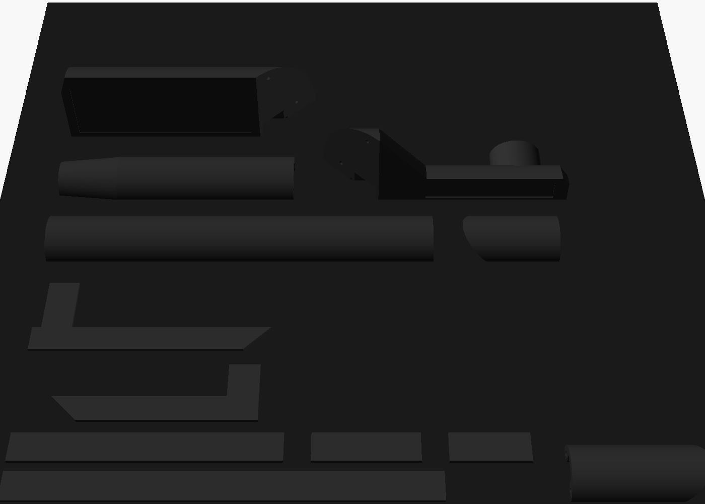

# RPLIDAR cable cover kit (v6 – fitted, fully enclosed)

This is the same route as v4: from the lidar, around the column ("neck"), across its front face over the USB adapter board, then out to the deck edge and down the side the cable already goes. The difference is that **every piece is now a closed tube**. A thin floor plate clicks into a flush recess underneath each piece, so the cables are fully enclosed and the covers don't rely on the robot's surfaces to close them.

| Floor plate lifted out (housing, upside down) | Board in the housing (cutaway) |
|---|---|
|  |  |

## Parts (print 1 of each)
| File | What it is |
|---|---|
| `lidar_run.stl` | Low dome from the lidar, with a tapered nose at the lidar |
| `side_strip.stl` | Strip along the column's lidar-side face. It has a built-in T-junction for the lidar run and wraps the front corner on a pinned 45° joint. |
| `front_housing.stl` | Runs across the column's front face (84 mm). The board stands on its edge inside, and the USB cable turns out toward the edge. |
| `deck_run.stl` | 158 mm dome from the housing to the edge piece |
| `edge_top.stl` + `edge_drop.stl` | Two-piece elbow that goes over the deck edge |
| `floor_plates.stl` | **All six floors in one print**, 1.2 mm thick |

## Measurements used
| What | Value |
|---|---|
| Column front face | 3 5/16" (84 mm) |
| Column front → deck edge | 9 1/8" (232 mm). Housing stub 34 + deck run 158 + edge piece 40 = 232. |
| Board | 1" × 1 9/16" (25.4 × 40 mm), plus a 1" (24 mm) Logitech plug |
| Lidar position | ~120 mm left of the column and ~60 mm behind its front (estimated from the photo) |

## Cable channel
The channel is 9 mm wide by 5 mm high once the floor is in, which fits the lidar cable and the USB-C cable side by side. The covers are a bit taller than in v4 to make room for the floor: the strips are 13 mm tall, the domes 9.5 mm and the housing 35 mm.

## Ready to print: Creality K2 Plus / K2 Pro, black PLA
Everything is in [`print/`](print/):

| File | Use it for |
|---|---|
| `lidar_cable_cover_K2_blackPLA.gcode` | **Print this.** All 7 parts on one plate. About **2 h 35 min** and **88 g** of black PLA. |
| `lidar_cable_cover_K2_plate.3mf` | The same plate laid out, to open in Creality Print and re-slice with its own K2 profile if you prefer. |
| `creality_k2_black_pla.ini` | The PrusaSlicer settings used |
| `render_plate.png` | Picture of the plate layout |

**Settings:**
- 0.4 mm nozzle, 0.2 mm layers, 3 walls, 20 % gyroid infill, no supports.
- Nozzle 225 °C on the first layer, then 220 °C. Bed 60 °C. Fan 100 %.
- 4 mm brim with a 0.15 mm gap, so it peels off cleanly.
- The G-code starts with the K2's own `START_PRINT` (heating and auto-levelling) and ends with `END_PRINT`.
- Everything fits within 15–278 × 15–252 mm, so it runs on both the K2 Pro (300 mm bed) and the K2 Plus (350 mm bed).

**How to start it:** open the `.gcode` in Creality Print and send it to the printer over Wi-Fi, or copy it to a USB stick and pick it on the printer's screen. If you print from the CFS, load the black PLA in any slot and choose that slot when you start the job.

The slicer reports short bridges inside the channels, the board pocket and the dowel holes. These are 9 mm or less, print fine at full fan, and are hidden once assembled.

## Printing
- Every STL is already oriented for printing and needs **no supports**.
- Matte black PLA or PETG. Use 0.16–0.2 mm layers, 3 walls and 20 % infill.
- Set the seam to "rear" or "aligned".
- If the floor plates are too tight or too loose in their recesses, change `plate_clr` (currently 0.1 mm per side).

## Assembly
1. **Dowels:** cut 1.75 mm filament into 8 mm pieces and press them into the end holes to line the pieces up.
2. **Board:** stand the board in the housing pocket, with the JST connector at the lidar end and the components facing away from the column.
3. **Cables:** turn each piece upside down, lay the cables in the channel, and press its floor plate in. Now each run is a closed tube.
4. **Tape:** stick the pieces down with thin double-sided tape in the recesses on the back and bottom faces.
5. **Elbow:** dowel `edge_top` and `edge_drop` together at the mitre and fit them over the deck edge.

The lidar is assumed to be on the **left**, standing at the deck front edge facing the column. Set `lidar_on_left = false` to mirror the kit.
