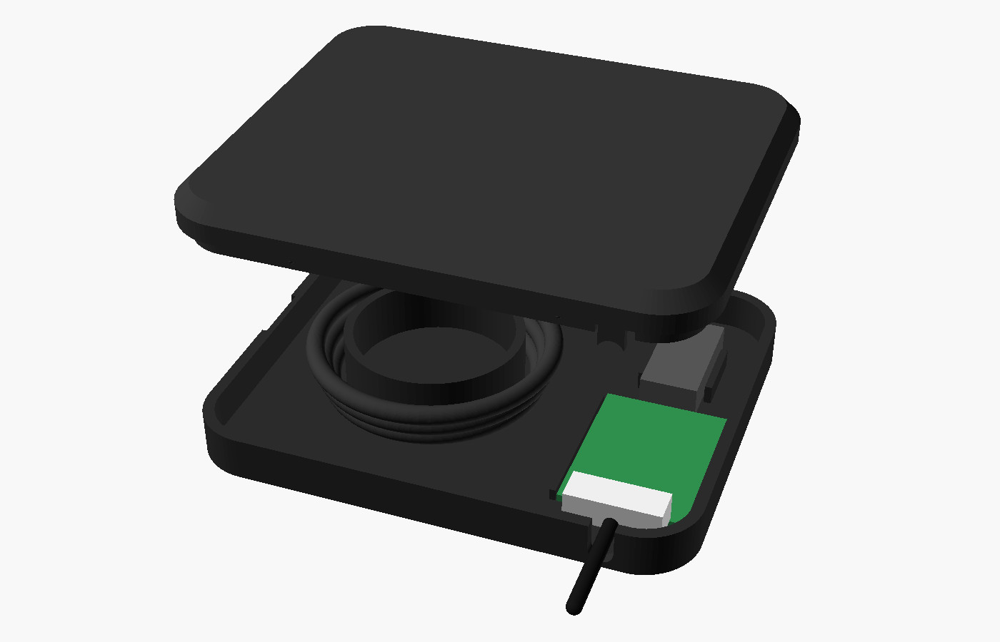

# RPLIDAR USB adapter pod (v5 – standalone)

A self-contained pod that sits on the deck by itself. It isn't attached to the column and doesn't route anything into the base. It holds the green USB adapter board and stores the spare USB cable. The lidar cable comes in one port and the USB cable leaves through another, toward the side it already goes.

| Closed | Inside (lid lifted) |
|---|---|
|  |  |

## Parts
| File | Size | Print |
|---|---|---|
| `pod_base.stl` | 103 × 85 × 10 mm (14.5 to the top of the post) | as is, flat on the bed |
| `pod_lid.stl` | 103 × 85 × 7 mm, plus a 3.5 mm lip | already flipped: top face down on the bed |

Closed, the pod is **103 × 85 × 17 mm**. Neither part needs supports.

## What's inside
- **Board cradle:** rails sized to the measured board (25.4 × 40 mm), plus a saddle that keeps the Logitech plug straight.
- **Coil post:** 38 mm across, so the USB cable's bend stays gentle. About 1 m of spare cable fits in three layers.
- **Cable ports:** round 5 mm ports. Each one is a U-slot in the base that the lid closes into a round hole around the cable, so you don't have to thread anything.
  - The **lidar port** is in the back wall, right behind the white JST connector.
  - The **USB port** is in the front wall.
- **Lid fit:** the lid has an inner lip and four small snap bumps, plus a ring that centres on the coil post.
- **Opening it:** a finger notch at the seam on the right-hand end lets you pop the lid off.
- **Mounting:** a shallow pocket under the base takes double-sided tape.

## Changing where the cables go
Both ports can be moved in `lidar_cable_cover.scad`:
```
lidar_port = [3, -35];   // [wall, offset]  wall: 0 = left end, 1 = right end, 2 = front, 3 = back
usb_port   = [2, -5];
```
Rotate the pod on the deck so the USB port faces the edge where your cable goes down to the computer. If a different wall suits better, change the number and re-export:
`openscad -o pod_base.stl -D 'PART="pod_base"' lidar_cable_cover.scad` (and the same for `pod_lid`).

## Printing
- Matte black PLA or PETG. Use 0.2 mm layers, 3 walls and 20 % infill.
- If the lid is too tight, lower `clear`. If it's too loose, raise it. It's currently 0.15 mm per side.

## Assembly
1. Set the board in the cradle, with the JST end toward the back port.
2. Plug in the lidar cable and lay it out through the back port.
3. Plug in the USB-C cable. Coil the spare loosely around the post, then lead the tail out through the front port.
4. Press the lid on until it clicks.
5. Stick the pod to the deck with double-sided tape, or leave it loose.

The earlier versions that ran along the column and into the base are in git history.
