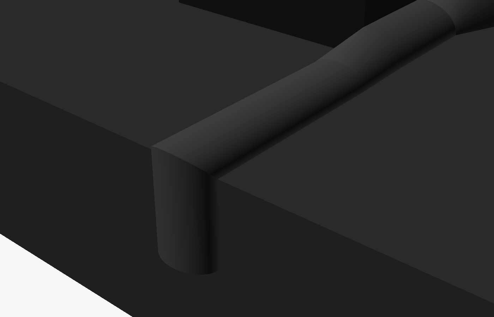

# RPLIDAR cable cover kit (v3 – stealth)

This is one continuous, low, rounded cover. It runs from the lidar to the mast base, along the bars, over the USB adapter board, and over the deck edge into the electronics bay. It's designed to look like part of the robot rather than an add-on.

| Detail | Board housing (cutaway) |
|---|---|
|  |  |

## Parts (print 1 of each)
| File | Size (L × W × H mm) | What it does |
|---|---|---|
| `lidar_run.stl` | 90 × 22 × 8 | Low dome from the lidar to the bar. Its tapered nose sits at the lidar, and the cable slips out of the tip. |
| `bar_run_entry.stl` | 70 × 16 × 11 | Quarter-round strip that tucks into the corner where the bar meets the deck. It has a built-in T-junction where the lidar run joins. |
| `board_housing.stl` | 125 × 24 × 26 | The adapter board **stands on its edge** against the bar, so the housing stays narrow. Its ends taper smoothly into the bar strips. |
| `bar_run_exit.stl` | 40 + 25 transition | Bar strip that flows into a dome where the cable leaves the bar |
| `deck_run.stl` | 60 × 22 × 8 | Plain dome segment to bridge any gap. Change `deck_len` to adjust. |
| `edge_top.stl` + `edge_drop.stl` | — | Two-piece elbow that goes over the deck edge. They join on a 45° mitre with dowels, so the corner looks like one piece. |

Earlier versions (box hub, wedge strips) are still in git history.

**Routing:** lidar → `lidar_run` → `bar_run_entry` (T-junction) → `board_housing` → `bar_run_exit` → `deck_run` → `edge_top` / `edge_drop` → into the bay.

## Measure first (dimensions are estimated from photos)
1. **Board pocket**: 85 long × 9 deep × 19 tall. The board stands on edge with its JST connector facing out from the bar. Set `pocket_*` to change it.
2. **Cables**: the channel is 9 × 5 mm, sized for the lidar cable plus the USB-C cable side by side (each about 4 mm or less).
3. **Bar length** and where the lidar cable should join it. Set `entry_len`, `entry_at` and `exit_len`.
4. **Distances**: from the lidar to the bar (`lidar_len`), and from the end of the bar to the deck edge (`deck_len`).
5. **Deck front face**: set `edge_drop` to how far the cable must go down to reach the bay opening.

**Turning a corner along the bars:** set `mitre_start` / `mitre_end`. Use `1` for an inside corner or `-1` for an outside corner. Each cuts a 45° mitre so two strips meet cleanly.

Re-export after edits: `openscad -o bar_run_entry.stl -D 'PART="bar_run_entry"' lidar_cable_cover.scad`

## Printing
- The STLs are already oriented for printing and need **no supports**. Every piece prints flat side down, and the elbow halves print with their mitres at 45°.
- **Matte black PLA or PETG** blends best with the robot's powder-coat finish.
- Use 0.16–0.2 mm layers, 3 walls, 20 % infill, and seam position "rear" or "aligned" so the seam lands on the hidden side.
- Use a smooth PEI or glass bed, or a textured sheet if you want the base faces matte as well.

## Assembly
1. **Dowels:** cut 1.75 mm filament into 8 mm pieces (2 per joint). Press them into the end holes so neighbouring pieces line up flush with no visible step. Add a drop of CA glue for a permanent joint, or leave them dry so the pieces can come apart.
2. **Board:** stand the board in the housing pocket on its edge, with the components facing away from the bar. It's a snug friction fit.
3. **Cables:** lay the cables in the corner along the bar and press the strips over them.
4. **Tape:** the back and bottom faces have 0.4 mm recesses for thin double-sided tape (3M 9088, 468MP or similar), so the pieces sit tight against the bar and deck without a visible tape line.
5. **Elbow:** dowel `edge_top` and `edge_drop` together at the mitre and fit them over the deck edge.
6. **Spare USB cable:** coil it and strap it inside the electronics bay. Better still, swap to a 25–30 cm right-angle USB-C cable.
