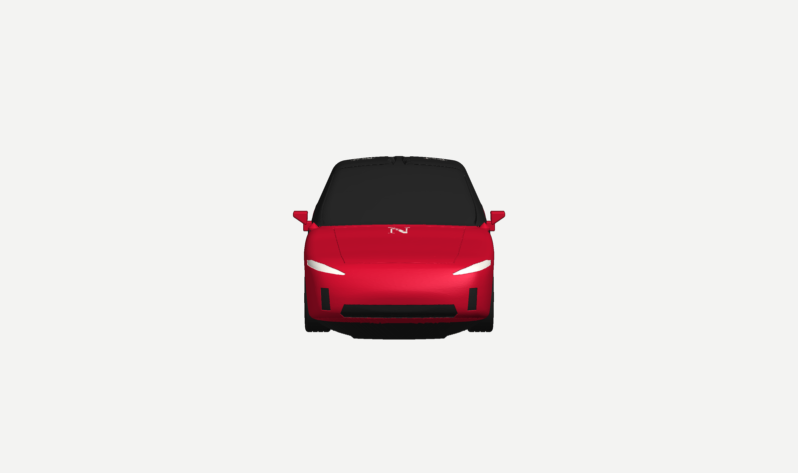

# Model X — Nebraska Huskers edition (1:24, print-in-place)

A 1:24 scale Tesla Model X (2021+ body) that prints **in one piece** with **four working doors**: two front-hinged front doors and two falcon-wing rear doors that lift up on a hinge in the roof spine. It's finished like a real car with a Huskers livery:

- **Red:** the paint, including the mirrors.
- **Black:** everything a real Model X has in black: all the glass and pillars, tyres and wheels, wheel-well liners, front intake and air curtains, smoked taillights, rear diffuser, door handles, the underbody, the whole interior, and the door seals.
- **White:** the Huskers accents: an **N** on the hood, **HUSKERS** across the tail, an **N** on each glass roof panel, and the LED headlights.

Inside there are seats, a dash and a steering wheel, so there's something to see when the doors are open.

| Closed | Doors open |
|---|---|
|  |  |
|  |  |

## Which file to print
| You have | Print this | What you get |
|---|---|---|
| K2 Plus / K2 Pro **with CFS** | `print/modelx_huskers_3color.3mf` in **Creality Print** (or OrcaSlicer). Red PLA in filament 1, white in 2, black in 3; map them to your CFS slots. | The full three-colour car. |
| Any K2, **no CFS** | `print/modelx_K2_1swap_PLA.gcode` | Load red. The printer pauses once at **Z 44.0 mm**; load black and resume. You get a red body with a black greenhouse. Tyres stay red and the lettering is engraved; colour them with a paint pen if you like. |
| Another printer / slicer | `stl/modelx_red.stl` + `stl/modelx_white.stl` + `stl/modelx_black.stl` loaded as one multi-part object, or the 3MF | Same as the CFS version. |
| Experimental | `print/modelx_K2_CFS_3color_EXPERIMENTAL.gcode` | PrusaSlicer three-colour G-code: `T0`/`T1`/`T2`, which the K2 firmware's CFS tool change (cut, unload, load, purge into the chute) should handle. **Untested on hardware.** Use the 3MF route unless you want to try it. |

Settings used (already in the G-code and profiles): 0.4 mm nozzle, **0.2 mm layers** (the gaps are designed for exactly this), 3 walls, 12% gyroid, PLA 220 °C / bed 60 °C, **no supports**, 3 mm brim, thick bridges **off**.

| | Single-swap G-code | CFS three-colour |
|---|---|---|
| Print time | about 8 h 50 min (slicer estimate) | about 9 h 55 min printing, plus about 265 CFS filament changes (roughly 2.5 min each, about 11 h). Black tyres and glass put colour changes on almost every layer, so plan on about 21 h. |
| Filament | about 250 g PLA: 186 g red, 64 g black | 115 g red, 160 g black, under 1 g white, plus purge from the changes (roughly 100–150 g) |
| Size on the bed | 211 × 95 × 70 mm (fits the K2 Pro's 300 × 300 bed) | same |

## After printing
1. Let it cool completely on the bed.
2. **Snap the print ties.** Each door is held by tiny breakaway tabs so it can't shift or swing while it prints: 2 at the bottom and 2 at the rear edge of each front door, and 3 at the bottom plus 2 at each end of each falcon door. They sit about 1 mm deep in the door gaps. Run a hobby blade along the gaps, or open each door with a firm, steady push, and trim any nubs.
3. **Front doors:** swing each door out from its rear edge. The first few openings are stiff while the hinge frees up.
4. **Falcon doors:** lift from the bottom rear corner. They open to 80° and close under their own weight. A detent clicks at closed and at fully open. It helps keep the doors shut, but it won't reliably hold a door up: the print-in-place hinge needs 0.35 mm of play, which is more than the detent's 0.25 mm bite. To display the car with the falcon doors open, prop them or add a dab of putty at the hinge.
5. If a door won't move at all, run a blade along its bottom edge to free the first layer from the sill.

## How it works
**Gaps.** Every door is a 2 mm shell cut out of the body surface. The body around it is carved away along the door's whole swept path from closed to fully open, plus a clearance gap. Measured on the finished parts, the closed gap is at least 0.31 mm (front doors) and 0.33 mm (falcon doors), and no door touches the body anywhere in its travel. `check.py` confirms this by rotating each door through its full range in 1° steps and intersecting it with the body.

**Front doors.** Each has a vertical pin hinge just behind the door's front edge: a 2.6 mm pin with 0.35 mm radial clearance, and 45° conical knuckle joints so nothing overhangs. The hinge sits in a narrow channel at the fender seam, printed black so it reads as a shadowed door gap. The doors open to 72°.

**Falcon doors.** Each hinges along the roof spine on a horizontal 2.6 mm pin with 9 knuckles. The door bores are teardrop-topped and let down 0.35 mm at the bottom, so the pin prints 3+ layers clear of the door. Each door also has two **detents**. A cam on a door knuckle pushes a two-line-wide nub on a flexing beam cut free in the spine; the nub clicks into notches at closed and fully open (80°). The roof panel's underside is a flat bridge over the second-row cabin, anchored on a 45° keel along its inboard edge. That's why opening the door opens the roof the way the real one does.

**Printability.** The car sits on its tyres (flattened contact patches) and on a hidden 45° keel under the floor, so it needs no supports. The flat areas print as bridges: the falcon roof panels, the front headliner, and the short wheel-well ceilings over the tyres. A few small cosmetic overhangs go steeper than 45° (tyre sidewalls next to the contact patch, mirror stalks, wheel-arch lips). `printability.py` checks two things:
- Layer by layer, everything that starts in mid-air begins 1–2 layers above the part under it: door bottoms over the sill, knuckles over their web.
- With `--parts`, slicing the body and doors separately, no door prints directly on the body or with only one empty layer between them, and no same-layer gap is under 0.25 mm.

## Accuracy, honestly
The overall size and layout match Tesla's published dimensions for the 2021+ Model X:

| | Full size (owner's manual) | Model (1:24) |
|---|---|---|
| Length | 5,057 mm | 210.4 mm (210.7 exact; the nose is rounded 0.35 mm short) |
| Width without / with mirrors | 1,999 / 2,271 mm | 83.3 / 94.8 mm |
| Height | 1,680 mm | 70.0 mm |
| Wheelbase | 2,965 mm | 123.5 mm |
| Track front / rear | 1,705 / 1,710 mm | 71.0 / 71.3 mm |
| Overhang front / rear | 988 / 1,104 mm | 40.8 / 46.0 mm |
| Tyres | 265/45R20 front, 275/45R20 rear (746 / 756 mm) | 31.1 / 31.5 mm |

The surfaces in between come from proportions and published key points, not from Tesla CAD. Tesla doesn't publish CAD, and blueprint sites were blocked from this session. Expect the silhouette, stance and colour layout to read as a Model X, but not every curve to match a scan. Things simplified for printing:
- **Falcon doors** use a single roof hinge (a gull-wing motion). The real door has a second, folding hinge at the top of the window.
- The **keel** under the floor fills the space between the sills and the ground. It's black, so from the side it reads as the shadow under the car.
- The **wheels** are fixed. They're a 5-double-spoke design in the spirit of the 20" wheels, not a copy of Tesla's.
- **Mirrors** have a sloped underside so they print without support.
- **No Tesla badges.** The Huskers N and HUSKERS are plain serif lettering, not the official artwork.

The **N** and **HUSKERS** marks belong to the University of Nebraska, and the Model X design to Tesla. This is for your own non-commercial print. Don't sell it or post it for others to download.

## Files
| File | What it is |
|---|---|
| `stl/modelx_red.stl`, `stl/modelx_white.stl`, `stl/modelx_black.stl` | The three colours, already in print position |
| `stl/modelx_one_color.stl` | Single-colour version (lettering engraved 0.5 mm) for the one-pause print |
| `print/*.3mf`, `print/*.gcode`, `print/*.ini` | Print files and the PrusaSlicer profiles that made them |
| `body.py` | Body shape: published dimensions and silhouette profiles |
| `geom.py`, `build.py`, `parts.py` | Door cutting, swept clearances, hinges, detents, wheels, interior, colours |
| `check.py`, `printability.py` | Door-swing collision check, plus the layer-by-layer and part-against-part print checks |
| `slice.py`, `export3mf.py`, `shots.py`, `render.py` | Print files, 3MF writer, renders |

Rebuild: `python3 build.py && python3 slice.py && python3 shots.py <cache> 0.200 renders`. Needs numpy, scipy, scikit-image, trimesh, manifold3d, numba and PrusaSlicer 2.7. The cache directory is `$MX_CACHE`, default `/tmp/mx_cache`.
