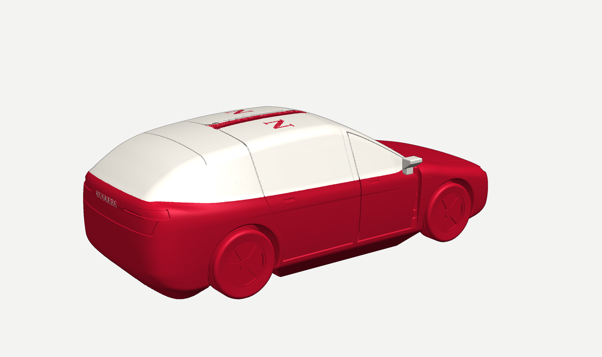
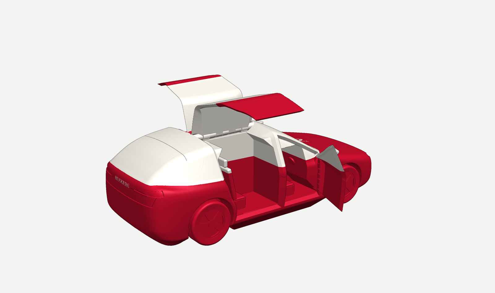
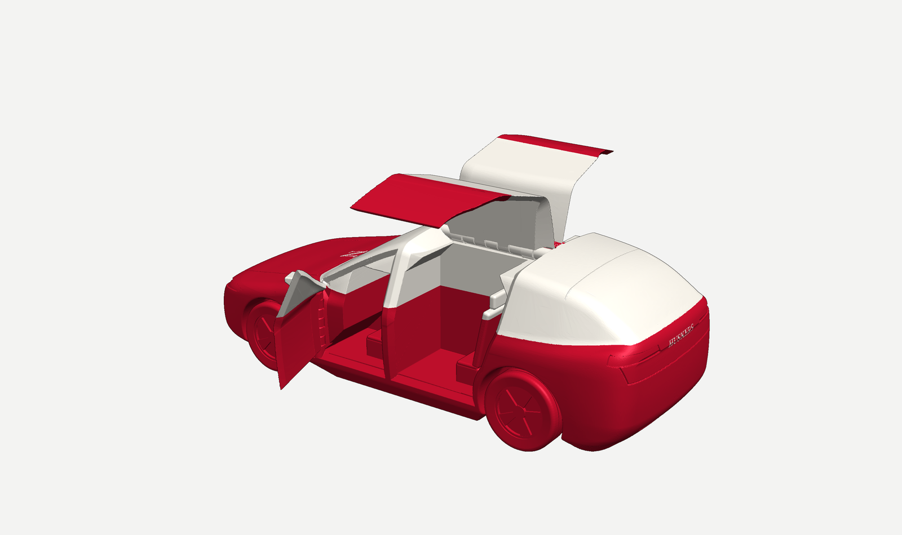
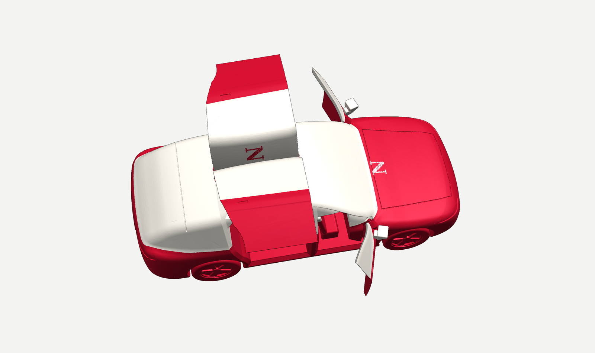

# Model X — Nebraska Huskers edition (1:24, print-in-place)

A 1:24 scale Tesla Model X (2021+ body) that prints **in one piece** with **four working doors**: two front-hinged front doors and two falcon-wing rear doors that lift up on a hinge in the roof spine. It's finished in Huskers red and white: a red body with a white greenhouse, a white **N** on the hood, white **HUSKERS** across the tail, and a red roof spine stripe with a red **N** on each falcon-door roof panel. The interior has seats, a dash and a steering wheel, so there's something to see when the doors are open.

| Closed | Doors open |
|---|---|
|  |  |
|  |  |

## Which file to print
| You have | Print this | What you get |
|---|---|---|
| K2 Plus / K2 Pro **with CFS** | `print/modelx_huskers_2color.3mf` in **Creality Print** (or OrcaSlicer). Red PLA in slot 1, white in slot 2. | Full livery (lettering, roof stripe, white mirrors). |
| Any K2, **no CFS** | `print/modelx_K2_1swap_PLA.gcode` | Load red. The printer pauses once at **Z 44.6 mm**; swap to white and resume. The lettering is engraved instead of two-colour. |
| Another printer / slicer | `stl/modelx_red.stl` + `stl/modelx_white.stl` as one multi-part object, or `print/modelx_huskers_2color.3mf` | Same as the CFS version. |
| Experimental | `print/modelx_K2_CFS_2color_EXPERIMENTAL.gcode` | PrusaSlicer two-colour G-code using bare `T0`/`T1`, which the K2 firmware's CFS tool change should pick up. **Untested on hardware.** Use the 3MF route unless you want to try it. |

Settings used (already in the G-code / profiles): 0.4 mm nozzle, **0.2 mm layers** (the gaps are designed for exactly this), 3 walls, 12% gyroid, PLA 220 °C / bed 60 °C, **no supports**, 3 mm brim, thick bridges **off**.

| | Single-swap G-code | CFS two-colour |
|---|---|---|
| Print time (slicer estimate) | about 8 h 20 min | about 8 h 20 min, plus roughly 2.5 h for 57 CFS filament changes |
| Filament | about 84 m / 250 g PLA (≈190 g red, 60 g white) | ≈63 m red + 21 m white, plus purge |
| Size on the bed | 211 × 95 × 70 mm (fits the K2 Pro's 300 × 300 bed) | same |

## After printing
1. Let it cool completely on the bed.
2. **Front doors:** hold the car and swing each door out from its rear edge. The first opening takes a firm push, because the knuckles start 2 layers apart and the first layers stick lightly.
3. **Falcon doors:** lift from the bottom rear corner. A hold-open detent clicks shut at 0° and clicks open at about 75–80°, where it holds the door up. Free it with a few gentle cycles. If a door is stiff, work it rather than forcing it.
4. If a door won't move at all, a fingernail or a blade along the door's bottom edge separates the first layer from the sill.

## How it works
**Gaps.** Every door is a 2 mm shell cut out of the body surface. The body around it is carved away by the door's whole swept path from closed to fully open, plus a 0.4 mm gap. A door therefore can't hit the body anywhere in its travel. `check.py` confirms this by rotating each door through its full range in 1° steps and intersecting it with the body.

**Front doors.** Each has a vertical pin hinge hidden behind the door's front edge: a 2.6 mm pin with 0.35 mm radial clearance and 45° conical knuckle joints so nothing overhangs. Opening angle is 72°.

**Falcon doors.** Each hinges along the roof spine: a horizontal 2.6 mm pin, 9 knuckles and teardrop bores. Each door also has two **detents**: a cam on a door knuckle, and a flexing beam with a nub cut free in the spine. The nub deflects 0.25 mm over the cam lobe and drops into notches at closed and fully open (80°). The roof panel's underside is a flat bridge over the second-row cabin. That's why opening the door opens the roof the way the real one does.

**Printability.** The car sits on its tyres (flattened contact patches) and on a hidden 45° keel under the floor, so there are no overhangs past 45° and no supports. `printability.py` slices the model layer by layer. Every island that starts in mid-air sits exactly 1–2 layers above the part beneath it: door bottoms over the sill, hinge knuckles over their web. Nothing floats higher than that.

**Colours.** The colours fall mostly in two height bands: the beltline and the roof. The CFS version needs only about 57 filament changes.

## Accuracy, honestly
The overall size and layout match Tesla's published dimensions for the 2021+ Model X:

| Full size (owner's manual) | Model (1:24) |
|---|---|
| Length | 5,057 mm | 210.4 mm (210.7 exact; the nose is rounded 0.35 mm short) |
| Width without / with mirrors | 1,999 / 2,271 mm | 83.3 / 94.8 mm |
| Height | 1,680 mm | 70.0 mm |
| Wheelbase | 2,965 mm | 123.5 mm |
| Track front / rear | 1,705 / 1,710 mm | 71.0 / 71.3 mm |
| Overhang front / rear | 988 / 1,104 mm | 40.8 / 46.0 mm |
| Tyres | 265/45R20 front, 275/45R20 rear (746 / 756 mm) | 31.1 / 31.5 mm |

The surfaces in between come from proportions and published key points, not from Tesla CAD. Tesla doesn't publish CAD, and blueprint sites were blocked from this session. Expect the silhouette and stance to read as a Model X, but not every curve to match a scan. Things simplified for printing:
- **Falcon doors** use a single roof hinge (a gull-wing motion). The real door has a second, folding hinge at the top of the window.
- The **keel** under the floor fills the space between the sills and the ground. From the side the car looks as if it has no ground clearance, but it doesn't need supports.
- The **wheels** are fixed. They're a 5-double-spoke design in the spirit of the 20" wheels, not a copy of Tesla's.
- **Mirrors** have a sloped underside so they print without support.
- **No Tesla badges.** The Huskers N and HUSKERS are plain serif lettering, not the official artwork.

The **N** and **HUSKERS** marks belong to the University of Nebraska, and the Model X design to Tesla. This is for your own non-commercial print. Don't sell it or post it for others to download.

## Files
| File | What it is |
|---|---|
| `stl/modelx_red.stl`, `stl/modelx_white.stl` | The two colours, already in print position |
| `stl/modelx_one_color.stl` | Single-colour version (lettering engraved 0.5 mm) |
| `print/*.3mf`, `print/*.gcode`, `print/*.ini` | Print files and the PrusaSlicer profiles that made them |
| `body.py` | Body shape: published dimensions and silhouette profiles |
| `geom.py`, `build.py`, `parts.py` | Door cutting, swept clearances, hinges, wheels, interior, colours |
| `check.py`, `printability.py` | Door-swing collision check and layer-by-layer float check |
| `slice.py`, `export3mf.py`, `shots.py`, `render.py` | Print files, 3MF writer, renders |

Rebuild: `python3 build.py && python3 slice.py && python3 shots.py <cache> 0.200 renders` (needs numpy, scipy, scikit-image, trimesh, manifold3d, numba, PrusaSlicer 2.7).
