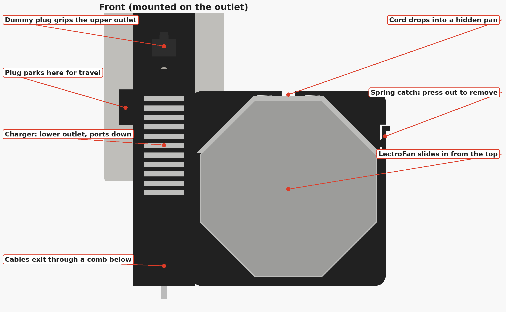
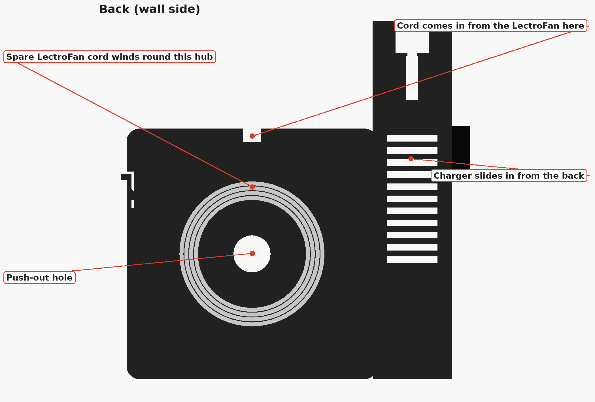
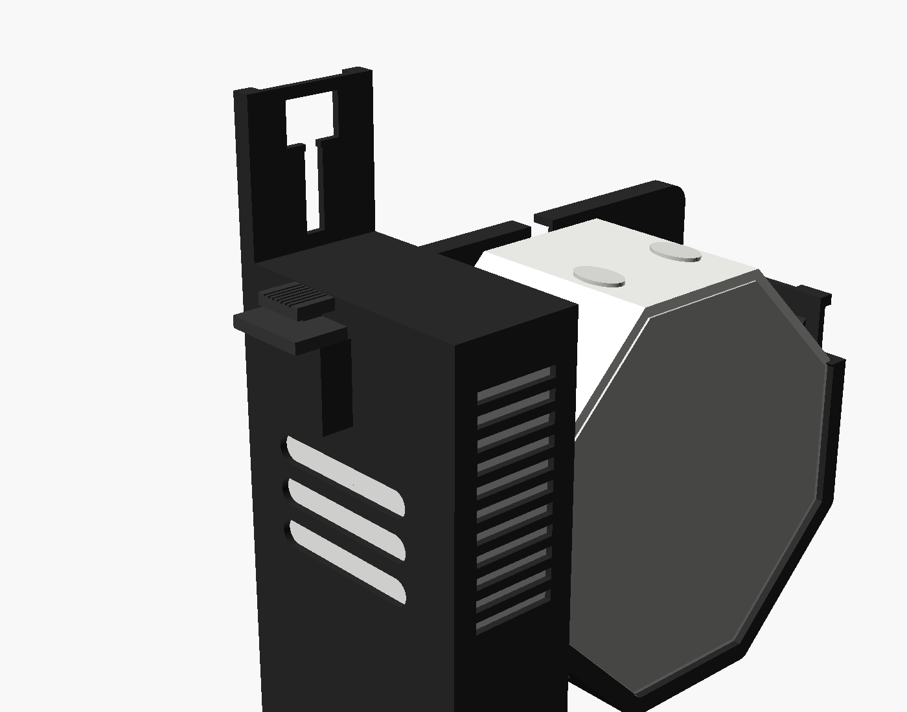

# NightDock: outlet mount + travel caddy

This is for the **Amazon Basics 4-port GaN charger** and the **LectroFan Classic**. Both live in one dock that you plug straight into a wall outlet, with the LectroFan's cord hidden inside. You pack the whole thing as one piece when you travel.

## How it stays in the outlet
A heavy charger in a worn hotel outlet sags and falls out. The dock fights that three ways:

1. **It holds onto both outlets.** The charger goes in the **lower** outlet. A small printed **dummy plug** (two plastic blades, like a child-safety outlet cap) grips the **upper** outlet. The dock hangs from both, and the upper one sits at the top where it best resists the dock tipping forward.
2. **The dummy plug finds the outlet on its own.** It slides ±7 mm up and down in its slot, so it lines up with any standard duplex outlet without you measuring anything. A small detent keeps it from wandering.
3. **The weight sits close to the wall.** The LectroFan sits *beside* the charger, flat against the wall, not stacked out in front, so there's very little leverage pulling the dock off. Two optional rubber feet on the back corners rest on the wall to keep it steady.

The cables also leave through a comb right under the charger, so a tug on your phone cable pulls on the dock instead of levering the charger out.

## What's inside
- **Charger pocket.** The charger slides in from the wall side, with its ports facing down onto two ledges. Crush ribs hold it, and slots let it breathe.
- **LectroFan cradle.** The LectroFan slides in from the top with its buttons facing up and its grille facing the room. A spring catch clicks over it so it can't slide out in your bag. Lips cover only the narrow rim of the grille.
- **Hidden cord pan.** The spare LectroFan cord winds around a hub behind the LectroFan. It goes in through a notch at the top and out at the lower left into the port bay.
- **Port bay and cable comb.** There's room under the charger for the plugs. The other cables snap into slots underneath.
- **Plug garage.** For travel, the dummy plug parks blades-down in a pocket on the side of the dock, so the blades can't snap in your bag.

| Packed for travel |
|---|
|  |

## Files
| File | What it is |
|---|---|
| `print/nightdock_K2_blackPLA.gcode` | **Print this.** The dock plus 2 dummy plugs (one spare) for the Creality K2 Plus/Pro, black PLA. About 3 h 20 min and 125 g. |
| `print/nightdock_K2_plate.3mf` | The same plate, to re-slice in Creality Print if you prefer |
| `frame_R.stl` / `frame_L.stl` | The dock with the LectroFan on the right or on the left of the charger |
| `anchor.stl` | The dummy plug, already laid on its side for printing |
| `nightdock.scad` | Parametric source (OpenSCAD) |

Both print with **no supports**. The dock prints standing on its back. The dummy plug prints on its side, so its blades lay down along their length and are as strong as possible.

> **Print the dummy plug in plain PLA or PETG only.** Never use carbon-fibre, metal-filled or "conductive" filament for it. It goes into a live outlet, so it must be fully non-conductive.

## Measurements used
| What | Value | From |
|---|---|---|
| Charger | 72.7 × 71.4 mm, ~31.6 mm thick | your calipers (thickness estimated from the photo) |
| Charger prongs | ~21.7 mm from the end without ports | photo (the sliding dummy plug absorbs any error) |
| LectroFan | 107.8 mm across the flats, 105.5 mm across the angled flats | your calipers |
| LectroFan height | designed for **56 mm** (spec 55.9) | your caliper photo looked closer to 52 mm |
| Outlet spacing | 38.1 mm (standard US duplex) | the slider covers ±7 mm |

**One thing to check:** if your LectroFan measures about 52 mm tall, stick four ~4 mm rubber feet (3M Bumpon style) on the four round marks on the LectroFan seat. They take up the gap, stop any buzzing, and isolate vibration from the wall. If it's 56 mm, no feet are needed.

## Setting it up
1. **Charger.** Push it into the dock from the wall side, prong face toward the wall, ports down onto the ledges.
2. **LectroFan cord.**
   - Plug it into the charger port **nearest the wall**.
   - From the back, lay it through the gap at the lower left of the round pan and wind the spare around the hub. The little tabs keep it in.
   - Bring the end up through the notch at the top.
3. **LectroFan.** Slide it in from the top, buttons up, until the catch on the right clicks. To remove it, press that catch outward and lift.
4. **Dummy plug.** Push its head through the T-shaped keyhole at the top from behind, then slide it down past the click.
5. **Mount.**
   - Unfold the charger prongs and push them into the **lower** outlet.
   - Nudge the dummy plug up or down by its ridged head until its blades line up with the **upper** outlet.
   - Press the whole dock home.
6. **Other cables.** Plug them into the free ports and snap them into the comb slots underneath.

**Travelling:**
- Pull the dock off the wall and fold the prongs.
- Slide the dummy plug up and out of the keyhole, then park it blades-down in the garage on the side.

## Notes
- The dock assumes a normal vertical duplex outlet. On a single outlet, or one turned sideways, it still works off the charger alone, just with less grip.
- It doesn't matter if the outlet is installed "upside down" (ground hole on top). The dummy plug has no ground pin.
- Set `HAND = "L"` for a left-hand dock, `lf_d` for the LectroFan height, and `ch_T` / `ch_ep` for the charger. Re-export with:
  `openscad -o frame_R.stl -D 'PART="frame"' nightdock.scad`
