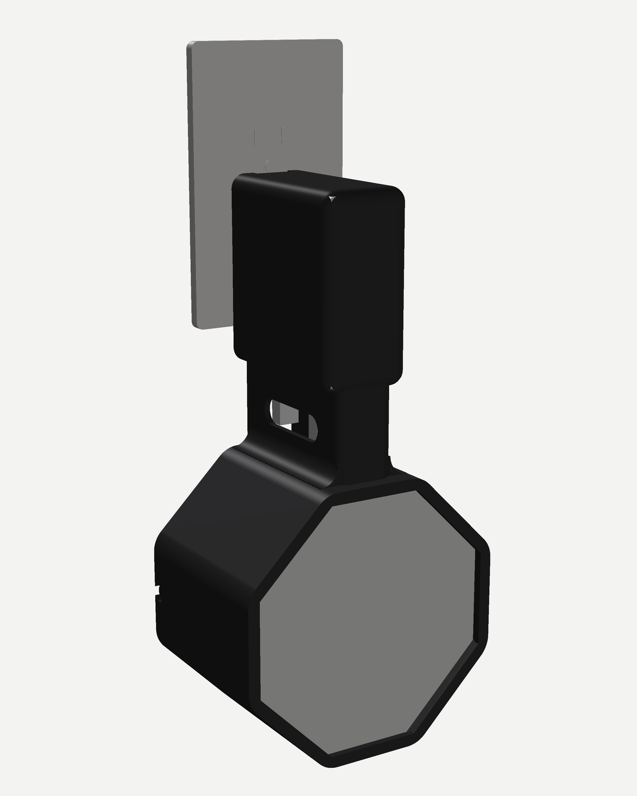
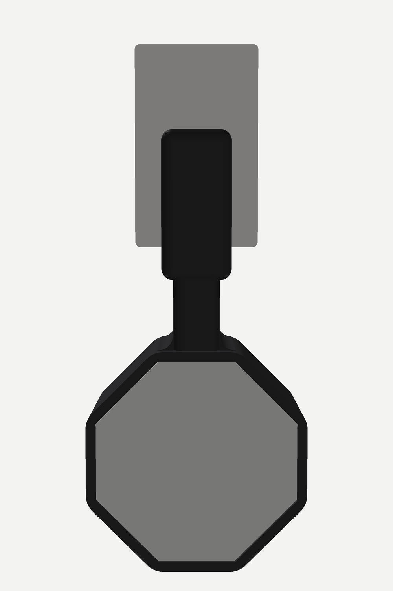
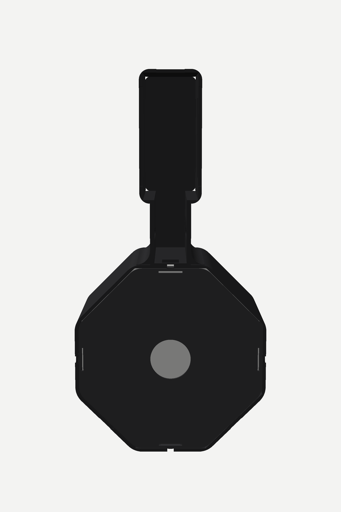
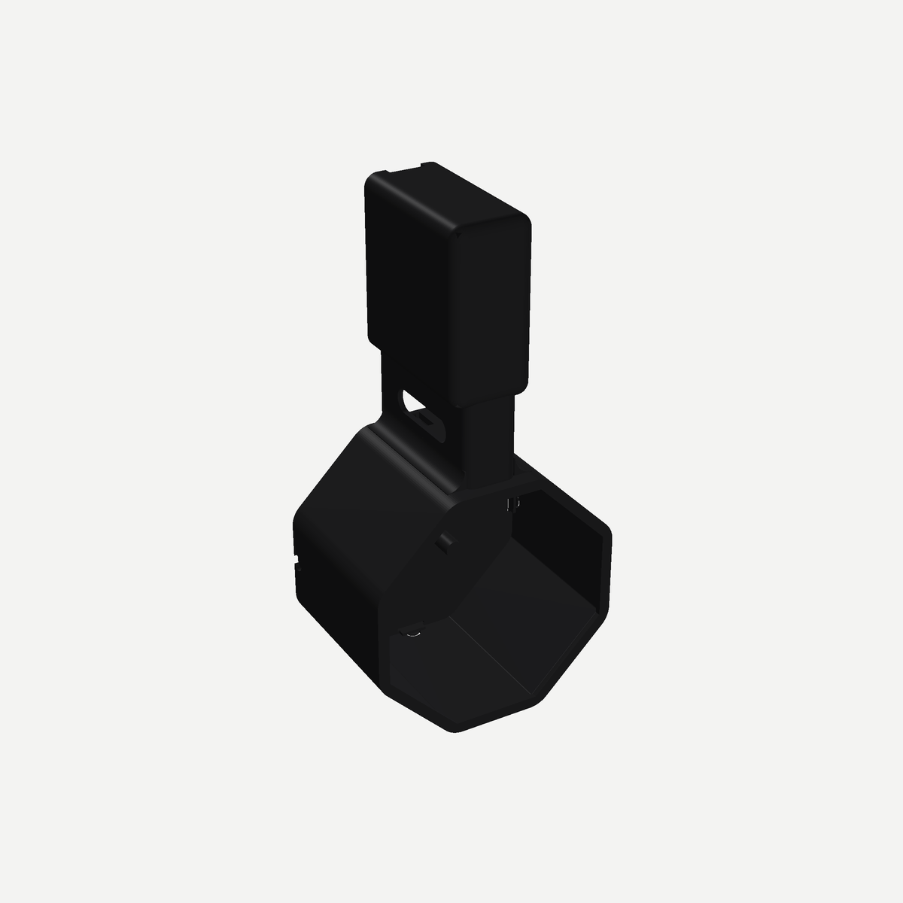

# NightDock

An outlet mount for the **Amazon Basics 4-port GaN charger** and the **LectroFan Classic**, in the style of a HomePod mini outlet mount. The charger sits in a rounded sleeve at the top and plugs straight into the wall. The LectroFan hangs below it in a rounded cradle with a continuous front bezel. Its spare cord is wound on a spool disc hidden behind it. Nothing is cut into the outside: no slots, slits or clips showing.

| Mounted | Front | Back |
|---|---|---|
|  |  |  |

## The two parts
| Part | What it does |
|---|---|
| **Dock** | Sleeve, neck and cradle in one piece. Prints on its back, no supports. |
| **Spool** | Octagonal disc that snaps into the back of the cradle. Three posts carry the spare cord, and the disc holds the LectroFan in. |

## How it goes together
1. **Charger.** Slide it into the sleeve from the wall side, prongs out, ports facing down. Ribs inside grip it. Hidden gaps at the back of the sleeve let air through.
2. **LectroFan.** Push it into the cradle **from the back**, grille first, buttons up, until it sits against the front bezel.
3. **Cord.** Plug the LectroFan cord into its jack, wind the spare around the spool's three posts, and lead the end through the notch at the top of the cradle into the neck. Plug it into the charger port nearest the wall.
4. **Spool.** Press the spool into the back of the cradle until its four fingers click. To take it out, pull on the finger hole in the middle.
5. **Other cables.** Plug them into the free ports and lead them out through the slot on either side of the neck.
6. **Mount.** Plug the dock into the outlet. Two 4–5 mm rubber bumpers on the round marks at the back lower corners make up for the cover plate's thickness so the dock sits flat. The weight hangs below the charger, flat against the wall, so there's very little leverage on the prongs.

## Files
| File | What it is |
|---|---|
| `print/nightdock_K2_blackPLA.gcode` | **Print this.** Dock + spool, Creality K2 Plus/Pro, black PLA. About 4 h and 148 g. |
| `print/nightdock_K2_plate.3mf` | The same plate, to re-slice in Creality Print if you prefer |
| `dock.stl`, `spool.stl` | The two parts, already oriented for printing |
| `nightdock.scad` | Parametric source (OpenSCAD) |
| `render.py` | The small renderer that made the pictures |

No supports. The sleeve's front face bridges 32 mm over the charger pocket, which PLA does fine at full fan; the slicer may warn about it.

## Measurements used
| What | Value |
|---|---|
| Charger | 72.7 × 71.4 mm, 31.6 mm thick (your calipers) |
| LectroFan | 107.8 mm across the flats, 105.5 across the angled flats (your calipers) |
| LectroFan height | designed for **56 mm** (spec). Your caliper photo looked closer to 52. |

**If your LectroFan is about 52 mm tall**, set `post_h = pan_d - spool_t + 4` in the `.scad` file and re-export the spool, so its posts reach the LectroFan's base:
`openscad -o spool.stl -D 'PART="spool"' nightdock.scad`
