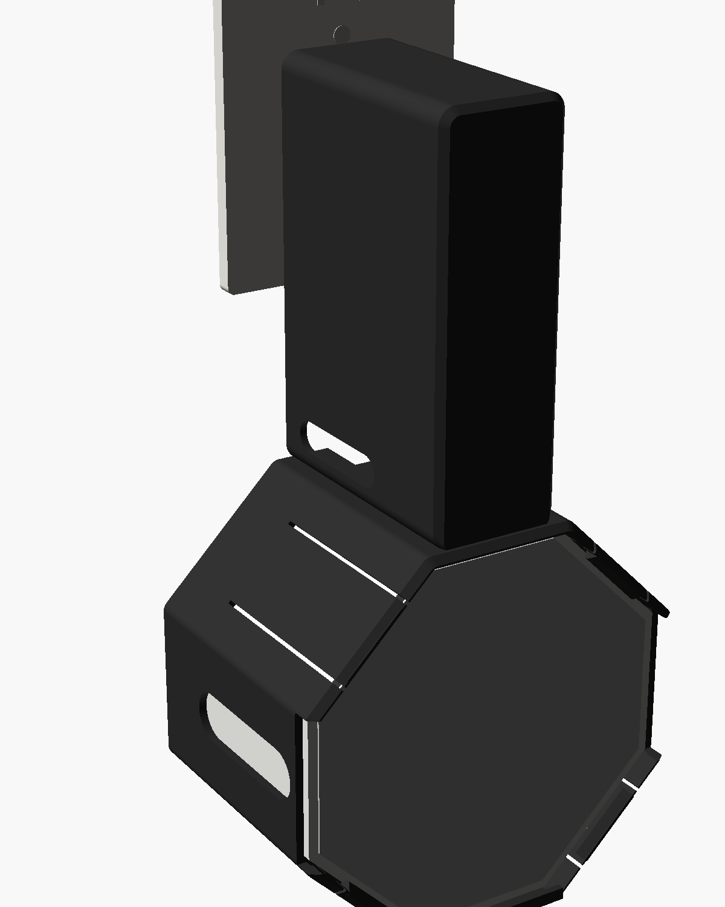
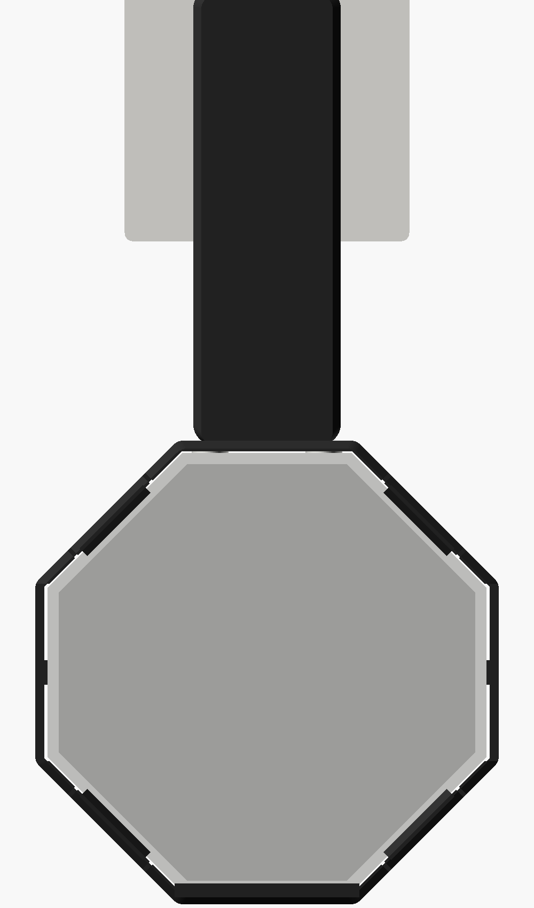
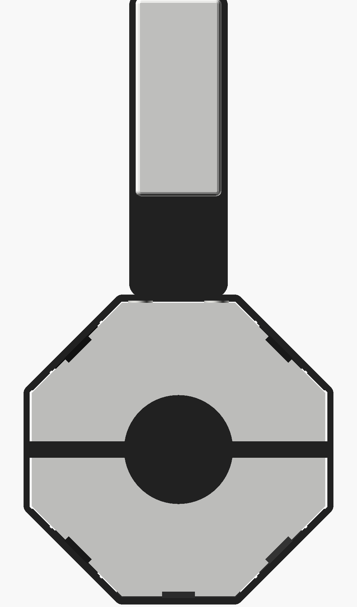

# NightDock

An outlet mount for the **Amazon Basics 4-port GaN charger** and the **LectroFan Classic**, in the style of a HomePod mini outlet mount. One printed piece, no moving parts. The charger sits in a sleeve at the top and plugs straight into the wall. The LectroFan hangs below it, and its spare cord spools in a pan behind it. For travel the whole thing comes off the wall as one block.

| Mounted | Front | Back |
|---|---|---|
|  |  |  |

## How it works
- **Sleeve.** The charger slides in from the wall side with its prongs out the back and its ports facing down. Ribs inside grip it so it stays put in your bag. Slots on the sides let it breathe.
- **Neck.** The short section under the charger has room for the plugs. Cables leave through the openings on either side, or straight out the back.
- **Cradle.** The LectroFan sits with its buttons up and the grille facing the room. A lip holds the bottom edge, and four spring catches click over the top and bottom corners. Push it straight in until it clicks. To remove it, pull the top edge forward.
- **Cord pan.** The pan behind the LectroFan is 15 mm deep: wind the spare cord around the hub, lead it through the notch at the top of the cradle into the neck, and plug it into the port nearest the wall. The pan also clears the DC plug on the LectroFan's base.

## Why it stays in the outlet
The weight hangs *below* the charger, flat against the wall, so there's almost no leverage pulling the prongs out. The dock's back rests on the wall 20 cm below the outlet, which takes the load off the prongs. To be sure, stick two 4–5 mm rubber bumpers on the round marks at the back lower corners: they make up for the outlet cover plate's thickness so the dock sits straight.

## Files
| File | What it is |
|---|---|
| `print/nightdock_K2_blackPLA.gcode` | **Print this.** Creality K2 Plus/Pro, black PLA. About 3 h 40 min and 128 g. |
| `print/nightdock_K2_plate.3mf` | The same plate, to re-slice in Creality Print if you prefer |
| `dock.stl` | The dock, already oriented for printing (lies on its back) |
| `nightdock.scad` | Parametric source (OpenSCAD) |

It prints with **no supports**. The sleeve's front face is a 32 mm bridge over the charger pocket, which PLA handles at full fan. The slicer may warn about it; ignore that.

## Measurements used
| What | Value |
|---|---|
| Charger | 72.7 × 71.4 mm, 31.6 mm thick (your calipers) |
| LectroFan | 107.8 mm across the flats, 105.5 across the angled flats (your calipers) |
| LectroFan height | designed for **56 mm** (spec). Your caliper photo looked closer to 52. |

**If your LectroFan is about 52 mm tall**, the catches won't reach its front edge. Stick four 4 mm rubber feet (3M Bumpon style) on its base, near the corners. They bring it forward to where the catches hold it, and stop any buzzing. Or set `lf_d = 52` in the `.scad` file and re-export:
`openscad -o dock.stl -D 'PART="dock"' nightdock.scad`

## Setting it up
1. Slide the charger into the sleeve from the back, prongs out, ports down.
2. Plug the LectroFan cord into the port nearest the wall. Wind the spare around the hub in the pan and bring the end out through the notch at the top of the cradle.
3. Push the LectroFan into the cradle, buttons up, until the catches click.
4. Plug in your other cables and lead them out the side openings.
5. Plug the dock into the outlet. If the outlet cover plate holds it off the wall, add the two rubber bumpers.
